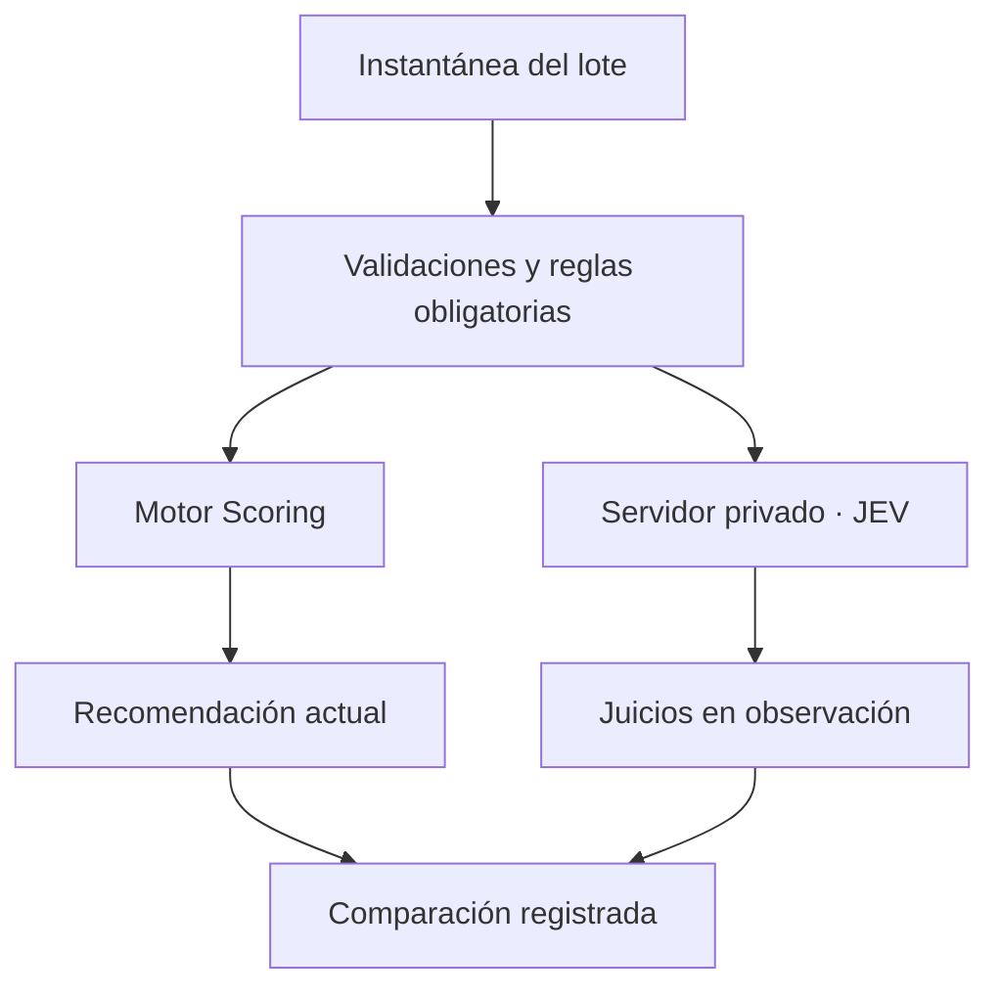

# JEV externo · contrato de integración v0.1

Fecha de revisión: 2026-10-11, America/Santiago.

Estado: diseño y ejemplo de petición preparados. No hay conexión activa, servidor
desplegado, credencial configurada ni llamada autenticada verificada. Los archivos
de la calculadora siguen intactos. Este documento define el siguiente bloque de
implementación; no certifica resultados del modelo en Amazon.

## 1. Base confirmada

- Repositorio: `jesusvvg/Calculadora-FBA-Amazon-Compuesto`.
- Rama de trabajo: `feature/jev-v1`.
- Base de código: `e2f96b15b1605d3a0f83fa539a98ef0b122531fc`.
- Respaldo: `backup/pre-jev-integration-2026-10-11`, mismo commit.
- Se verificó el respaldo con las referencias descargadas de GitHub.
- El respaldo Git conserva código. Los datos del navegador en `localStorage`
  requieren su propia exportación antes de cualquier migración futura.

La revisión encontró ya implementados Financial, Market, Rotation, Risk, Capital
Efficiency, Data Confidence y una decisión heurística con puertas obligatorias.
También existe captura de predicción y resultado por operación. La afirmación
previa de que todos esos bloques estaban pendientes era demasiado amplia:
queda validación y evolución, pero hay código operativo.

## 2. Proveedor y API verificados

Se usará directamente TypeSafe AI. JEV Hub se identifica como sitio comunitario;
sus guías son ejemplos, no validación de desempeño comercial.

| Elemento | Valor documentado por TypeSafe al revisar |
|---|---|
| Endpoint | `POST https://api.typesafe.ai/v1/systemone` |
| Autenticación | `Authorization: Bearer <API_KEY>` |
| Cuerpo | `state`, `model`, `questions` |
| Modelo fijado para primeras comparaciones | `jev-1.13.0` |
| Respuesta | `model`, `answers`, `usage` |
| Tipos | `choice`, `score`, `noul` |
| Precio publicado | USD 0.042 por millón de tokens de entrada; salida gratuita |

Precio, acceso y disponibilidad se vuelven a comprobar al activar la cuenta.
Fijar versión permite comparar consultas sin un cambio silencioso de alias.

Distinciones necesarias:

- `choice`: categoría elegida, distribución de probabilidades y `confidence`.
- `score`: valor sobre una rúbrica ordenada, distribución y `confidence`.
- `noul`: probabilidad modelada de que la respuesta a la pregunta sea sí; no
  trae un campo independiente de confianza.
- `confidence` resume la concentración de la distribución. No es una garantía
  de corrección ni equivale al Data Confidence de nuestra aplicación.
- Ninguna de estas salidas mide automáticamente la probabilidad de beneficio,
  las ventas futuras o la recuperación del capital.

El fabricante documenta dificultades con aritmética, fechas, instrucciones
ambiguas, datos irrelevantes y contenido adversarial. Todos los cálculos y
comparaciones numéricas permanecen en código.

## 3. Alcance y valor para el MVP

Problema: contrastar señales financieras y de mercado antes de comprometer
capital, manteniendo una referencia reproducible del análisis.

Dato necesario: instantánea del lote efectivamente elegido, economía calculada,
mercado manual, fechas/fuentes y campos faltantes explícitos.

Efecto inicial sobre una decisión: ninguno. JEV opera en **modo observación**.
Se muestran o registran sus juicios aparte; las recomendaciones, operaciones y
capital siguen controlados por el sistema actual.

Riesgo principal: JEV y Scoring reciben datos comunes y pueden equivocarse de
forma correlacionada. Coincidir no demuestra acierto. Si solo repite las reglas,
la integración no aporta valor y se debe reducir o posponer.

No habrá mezcla 70/30, probabilidad de éxito sintética, compra automática,
reposición o escalamiento habilitados por JEV en v0.1.

## 4. Arquitectura propuesta

- La PWA conserva su funcionamiento local. Una consulta será una acción
  explícita, no una llamada por cada pulsación del formulario.
- Un endpoint privado futuro recibirá solo el esquema permitido, validará la
  sesión, construirá las preguntas fijas y llamará a TypeSafe.
- `TYPESAFE_API_KEY` será un secreto del servidor. Nunca va en JavaScript
  público, GitHub, `localStorage` ni caché del service worker.
- CORS no sustituye autenticación. El servidor necesita autenticación, límite
  de consultas, tamaño máximo de entrada y presupuesto de uso.
- El navegador no podrá seleccionar un proveedor arbitrario ni cambiar las
  preguntas del servidor.
- La respuesta de JEV no podrá escribir compras, cerrar lotes, modificar
  presupuesto/reserva ni activar el botón de compra.

## 5. Contrato interno y correspondencia con el código

La instantánea interna tendrá versión, identificador de análisis, fecha,
huella del contenido, lote elegido y salida del Scoring. Esos metadatos sirven
para auditoría; no se envía todo el registro a TypeSafe.

| Bloque enviado a JEV | Fuente actual | Tratamiento |
|---|---|---|
| Producto | `jev_v1.product` | Marketplace, condición; identificador local separado |
| Elegibilidad y match | `jev_v1.eligibility`, `verification.productMatch` | Puerta obligatoria antes de consulta; conservar fecha/fuente |
| Economía del lote | `MOTOR_SCORING_ENGINE.evaluatePurchaseFinancial(units, investment)` | Recalcular para cantidad elegida; importes USD, ratios 0–1 |
| Capital | `AMAZON_CAPITAL_BALANCE(null, investment)` | Disponible antes/después; inversión real del lote |
| DTC | `MOTOR_SCORING_PHASE5.rotation.dtc` | Etiquetar como estimación; no como resultado observado |
| Mercado | `jev_v1.market` | BSR, tendencia, ventas mensuales del listing, sellers FBA, precios, Buy Box, Amazon y estacionalidad |
| Rotación y riesgo manual | `jev_v1.rotation`, `risk`, `returns`, `verification.exitPlan` | Preservar desconocidos y supuestos |
| Calidad de datos | Cobertura/frescura y valores faltantes | Completitud determinista; no sustituirla por confianza de JEV |

Excluir de la petición: scores internos, recomendación interna, credenciales,
historial íntegro, proveedores identificables y cualquier dato personal.
Ocultar la salida del Scoring reduce el anclaje; no elimina la dependencia
estadística entre los dos sistemas.

Reglas de preparación:

1. Obtener los campos de una única instantánea coherente. Si los módulos están
   recalculándose o los datos no corresponden al mismo lote, no consultar.
2. Usar la cantidad elegida, no mezclar finanzas del lote ingresado con las del
   piloto limitado. Recalcular costos por lote una sola vez y costo por unidad.
3. Si falta una cifra, enviar `null` y registrar el campo faltante. Cero es un
   valor válido únicamente cuando se introdujo/comprobó explícitamente.
4. Usar USD para importes comparables, ratios 0–1 y días para DTC; rechazar
   moneda/tipo de cambio indeterminados. No inventar conversiones.
5. Las ventas mensuales del listing NO equivalen a nuestras ventas. No asignar
   demanda dividiendo simplemente por el número de sellers.
6. Calcular antigüedad en días y comparaciones de precio en código, usando
   las fechas disponibles. Un registro manual reciente no valida su exactitud.
7. Adjuntar origen `MANUAL`, `SIMULATED` o fuente futura comprobada. Separar
   datos observados, estimaciones y simulaciones.
8. Omitir de inferencia las dimensiones cuyo mínimo de datos no está presente;
   reportarlas localmente como `INSUFFICIENT_DATA`. No pedir que rellene huecos.
9. La huella de consulta cubre cantidad, costos, precio, mercado, capital y
   versión de preguntas. Cambiar cualquiera invalida su uso para el lote.

## 6. Cinco juicios propuestos

Se usa `choice` con tres opciones por juicio: una opción favorable, una
desfavorable y `insufficient_data`. Permite expresar falta de evidencia sin
convertirla en riesgo alto o atractivo bajo.

| ID | Juicio acotado | Mínimo de datos |
|---|---|---|
| `financial_resilience` | ¿Hay evidencia cualitativa que contradiga la resistencia financiera ya calculada? | Economía completa, escenario pesimista y fuente/supuestos |
| `rotation_support` | ¿Los datos de demanda sustentan la rotación estimada del lote? | DTC, tamaño de lote, estimación de ventas y tendencia BSR |
| `market_pressure` | ¿Hay señales observadas de presión competitiva? | Sellers actuales/históricos, guerra de precios, estabilidad y Amazon seller |
| `inventory_lockup` | ¿Hay señales que cuestionan el plazo de recuperación estimado? | DTC, sell-through, estacionalidad y salida alternativa |
| `pilot_evidence` | ¿La evidencia específica del producto permite considerar el piloto propuesto? | Puertas superadas y datos mínimos de los cuatro juicios anteriores |

Las preguntas se escribirán completas: el fabricante aclara que los IDs no
se usan como instrucciones del modelo. Se usa inglés en la consulta y español
en la interfaz; es una decisión de implementación basada en su documentación
de idiomas, que también requiere validación en nuestro dominio.

El quinto juicio sintetiza varias señales y puede ser redundante; se incluye
como hipótesis de evaluación, no como autoridad de compra. Si las pruebas
muestran que añade confusión, se elimina. El juicio financiero también debe
demostrar valor adicional frente al cálculo determinista.

`examples/jev-v0.1-request.simulated.json` contiene una petición ilustrativa
con cinco preguntas. Es una simulación independiente, NO una exportación de
las operaciones guardadas ni una respuesta obtenida del servicio.

## 7. Recepción, estados y comparación

Estados locales previstos: `DISABLED`, `BLOCKED`, `PENDING`, `READY`,
`INSUFFICIENT_DATA`, `STALE`, `UNAVAILABLE`, `INVALID_RESPONSE`.

| Caso | Comportamiento v0.1 |
|---|---|
| Elegibilidad no autorizada/no verificada/requiere aprobación | No consultar para una compra; conservar DESCARTAR/ESPERAR del Scoring |
| Puerta de match/origen/marca o economía bloquea | Conservar bloqueo; JEV no puede levantarlo |
| Capital insuficiente o límite impide el lote | Conservar validación de compra, sin aprobación por IA |
| Respuesta favorable | Registrar juicio aparte, sin aumentar unidades ni score |
| Respuesta adversa o datos insuficientes | Mostrar señal de revisión, sin fabricar una causa textual de JEV |
| Desacuerdo | Señalar dimensiones concretas para revisión; no afirmar independencia ni acierto |
| Timeout, 401, 429, 529 o desconexión | JEV no disponible; calculadora sigue operativa, sin inventar resultado |
| Respuesta mal formada/parcial | Rechazarla para comparación; mostrar estado específico |
| Cambio de lote/ASIN/datos durante la llamada | Guardar respuesta bajo análisis original; no aplicarla al análisis actual |

El receptor verificará: modelo informado, IDs solicitados, `type`, opción
perteneciente a la rúbrica, probabilidades finitas dentro de 0–1, suma cercana
a 1 y confianza finita dentro de 0–1. Validará también que la opción elegida
sea de máxima probabilidad (admitiendo empates y tolerancia numérica).

Guardar: versión del contrato/preguntas/modelo, instantánea y huella locales,
hora, respuesta validada, latencia, tokens, estado de consulta y resultado del
Scoring. No guardar secretos ni registrar cuerpos con datos sensibles.

No habrá etiquetas de concordancia ALTA/MEDIA ni umbrales automáticos de
compra en esta fase. Probabilidad y confianza se conservan separadas; la UI
explicará que son juicios del modelo, no probabilidad de ganancia.

Si posteriormente se habilita una política de revisión, una señal adversa
validada podría exigir revisar, pero nunca liberar una puerta ni promover
ESPERAR/DESCARTAR a COMPRAR. Esa política no está habilitada ahora.

## 8. Verificación necesaria antes de activar

- Prueba autenticada en servidor con un caso sintético y respuesta validada.
- Casos de cada puerta de elegibilidad, economía y capital: ninguna consulta
  o respuesta podrá permitir una compra bloqueada.
- Comparaciones con faltantes, cero explícito, datos antiguos y contradictorios.
- Cantidad cambiada y reparto de costo por lote: misma economía que la compra.
- Cambio de ASIN durante una llamada, llamadas duplicadas y respuesta tardía.
- API caída, límites, sobrecarga y respuesta inválida: sin alterar operaciones.
- Reordenar opciones y reformular preguntas equivalentes para comprobar
  estabilidad; no asumir que la forma de preguntar es inocua.
- Casos adversariales: texto de origen no debe reescribir política/preguntas.
- Confirmar que la clave no aparece en archivos públicos ni registros.
- Comparar contra Scoring solo, registrando utilidad adicional, errores,
  abstenciones y desacuerdos. Las simulaciones no calibran rentabilidad real.
- Tras reunir resultados reales suficientes, medir valor de JEV sobre ese
  histórico con separación temporal de entrenamiento/evaluación. No elegir
  un umbral universal de 0.5 ni fijar porcentajes de éxito sin evidencia.

## 9. Lo que queda por implementar

1. Adaptador de instantánea y selección de campos, aislado de compras/cierres.
2. Endpoint privado con secreto TypeSafe, autenticación y control de gasto.
3. Validación estricta de respuesta y prueba autenticada.
4. Panel JEV opcional con estados explícitos y registro separado.
5. Banco de comparación y revisión de las cinco preguntas.

La cuenta, credencial y entorno de servidor aún no están configurados en esta
sesión. No pedir ni pegar la clave en el chat: configurarla como secreto del
entorno elegido al preparar el servidor.

## 10. Fuentes primarias consultadas

- https://typesafe.ai/ — sitio del proveedor y enlaces a documentación/consola.
- https://docs.typesafe.ai/introduction/quickstart — autenticación y primera llamada.
- https://docs.typesafe.ai/api — contrato HTTP y errores.
- https://docs.typesafe.ai/models — versión, precio y límites publicados.
- https://docs.typesafe.ai/primitives — preguntas, aislamiento e IDs.
- https://docs.typesafe.ai/confidence — significado de confianza y probabilidades.
- https://docs.typesafe.ai/model-jaggedness/jev-1.13 — limitaciones documentadas.
- https://arxiv.org/abs/2609.37647 — evaluación en otras tareas; no valida Amazon
  ni las cinco preguntas propuestas aquí.
